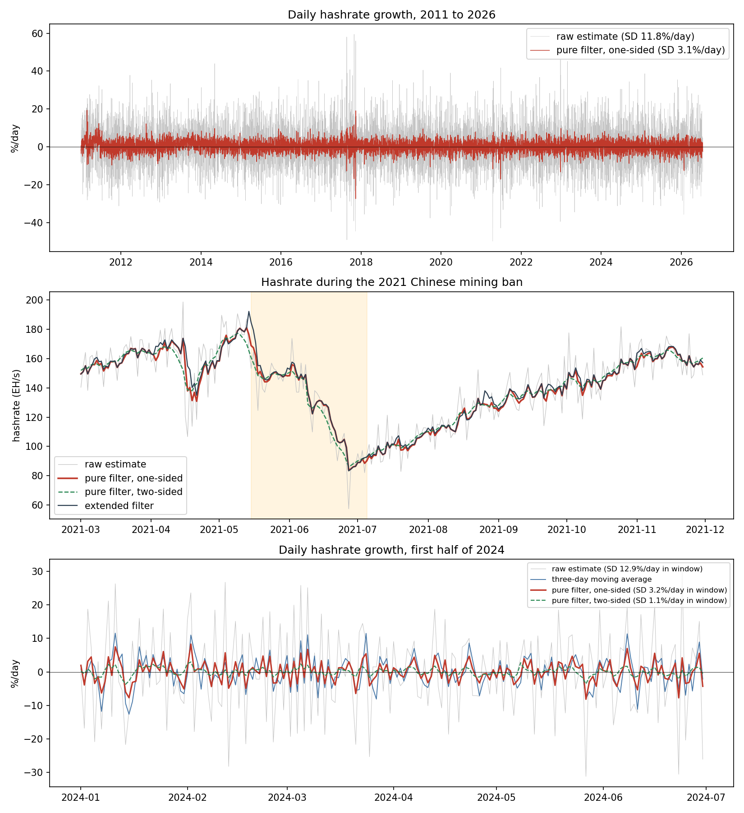

# hashrate-filter

A Python package that estimates the daily Bitcoin network hashrate from
block data and removes most of the luck in block discovery. It implements
the hashrate filter of Wüstenfeld and Geldner (2026) and runs on any daily
block series with per-block timestamps and difficulty.

Bitcoin's hashrate has to be inferred from how many blocks the network
finds, and block discovery is a lottery. Given the difficulty, a day's
block count is Poisson with an expected value of 144, so luck alone moves a
raw daily estimate by about 11.8% a day and accounts for 96% of the
variance of its daily growth. Published series reduce this noise with
moving averages, weekly or monthly aggregates, or local linear smoothing. A
moving average damps luck and real changes alike, and because each day's
noise leaves a window of length w after w days, it adds an autocorrelation
spike at lag w to the series. The filter instead uses the known
distribution of the luck, so there is no window length or bandwidth to
choose.

In the paper, the filter removes 95.6% of the Poisson-luck variance in
daily growth from 2016 onward (93.6% over 2011 to 2026). On an ordinary day
it records 31% of a lasting hashrate change on the day itself, half by the
next day, and 95% within a week. It captures 97% of the hashrate decline
during the 2021 Chinese mining ban, and from 2016 onward it predicts the
next day's block count better than the three-day moving average and the raw
estimate (mean Poisson predictive log-likelihood -4.095, against -4.167 and
-4.484).



Top: daily growth of the raw estimate and of the pure filter, 2011 to 2026.
The raw estimate's growth is about four times as dispersed (11.8% against
3.10% per day), and the difference is block luck. Middle: the 2021 Chinese
mining ban. The one-sided filter follows the decline as it happens, while
the two-sided version moves before the shock because it uses the following
days. Bottom: daily growth in the first half of 2024, with the three-day
moving average for comparison.

## Install

```bash
pip install -e .              # from a clone of this repository
pip install -e ".[examples]"  # adds matplotlib and pyarrow for the examples
pip install -e ".[test]"      # adds pytest for the test suite
```

The package needs Python 3.10 or later, numpy, pandas and scipy.

## Quick start

The repository ships a raw daily hashrate series, so the filter can be run
at once:

```python
import numpy as np
import pandas as pd
from hashrate_filter import pure_filter

d = pd.read_csv("examples/data/example_output.csv", parse_dates=["date"])
res = pure_filter(d["raw"])                  # raw daily estimate in H/s

hashrate = np.exp(res.h_filt)                # filtered hashrate in H/s
band = 1.96 * np.sqrt(res.P_filt)            # 95% band in log units
lower, upper = np.exp(res.h_filt - band), np.exp(res.h_filt + band)
```

Without block arrival times the arrival-time weight is zero on every day,
so the filter uses the quiet-day variance throughout.

The paper's filter also uses when the day's blocks arrived. The repository
ships three months of block data (May to July 2021, the window of the
Chinese mining ban), so the full construction runs immediately:

```python
import numpy as np
import pandas as pd
from hashrate_filter import daily_evidence, pure_filter

blocks = pd.read_csv("examples/data/sample_blocks_2021-05-01_2021-07-31.csv",
                     parse_dates=["time", "median_time"])

# raw daily hashrate in H/s, with blocks assigned to days by median time
day = blocks["median_time"].dt.normalize()
daily = blocks.sort_values("id").groupby(day).agg(
    n=("id", "size"), D=("difficulty", "mean"), D_open=("difficulty", "first")
)
daily["H"] = daily["n"] * daily["D"] * 2**32 / 86400

# daily arrival-time weight
ev = daily_evidence(blocks["time"])
pi_d = pd.Series(daily.index).map(ev["pi"])
assert pi_d.notna().mean() > 0.9, "dates of weights and series do not match"

res = pure_filter(daily["H"].values, pi_d=pi_d.fillna(0.0).values)
hashrate = np.exp(res.h_filt)
```

All timestamps are UTC. If the weights and the daily series are indexed
differently (for example one timezone-aware and one naive), every weight is
missing, and filling the gaps with zero silently removes the arrival-time
information. The assertion above catches this. The sample is cut by median
time, so its last few header times fall just after midnight on the
following day, and `daily_evidence` warns that this trailing day is
incomplete. It is not one of the 92 daily rows and is ignored.

The quiet-day variance fitted on three months of blocks is illustrative
only. Use the paper's value on short samples, `pure_filter(...,
q_quiet=7.81e-4)`; the Real-time use section below shows how to freeze the
weights as well.

## Input data

The filter needs one row per block with three fields:

| column | content |
|---|---|
| `time` | block header timestamp, UTC |
| `median_time` | median of the header timestamps of the last eleven blocks, UTC |
| `difficulty` | the block's difficulty |

The examples also use a block identifier `id` to count blocks. The
arrival-time weight uses the header timestamps, while the daily count and
difficulty are assigned to days by median time, which a single misdated
header cannot move. The raw daily hashrate in H/s is
`n_blocks x mean_difficulty x 2^32 / 86400`. The extended filter's anchor
uses the day's opening difficulty (the day's first block), so a reset
enters once, on the first day that runs at the new difficulty.

The daily series must have one row per consecutive calendar day, with no
gaps. The recursion steps one row per day and does not see dates, so a
missing day silently becomes a one-day step; pass `dates=` to have gaps
rejected.

`pure_filter` takes the raw one-day estimate. The observation variance of
1/144 holds for a series built from a single day's block count, so a
provider series that is already averaged over several days does not satisfy
the model. Any full node (for example Bitcoin Core's `getblockheader`,
fields `time`, `mediantime` and `difficulty`) or block explorer export
provides the three fields; Blockchair's daily dumps carry them at
https://gz.blockchair.com/bitcoin/blocks/. The paper uses Blockchair's
daily block extracts from the genesis block on 3 January 2009 to 15 July
2026, with the estimation sample starting on 1 January 2011 (958,214
blocks; two blocks, heights 854599 and 854614, are absent from the source
dump).

## Output

Both filters return a `FilterResult`:

| field | content |
|---|---|
| `h_filt` | one-sided estimate of the log daily hashrate (log of the input units) |
| `P_filt` | its variance; `h_filt +/- 1.96 sqrt(P_filt)` is the 95% band |
| `h_smooth`, `P_smooth` | two-sided estimate and its variance, if `two_sided=True`, else `None` |
| `q_quiet` | the fitted quiet-day state variance |
| `loglik` | log-likelihood of the one-step prediction errors at `q_quiet` |
| `q_path` | the daily state variance `q_t` used in the recursion |
| `anchor_var` | variance of the difficulty observation (extended filter) |

## The model

Let `y_t` denote the raw daily log hashrate estimate and `h_t` the log of
the day's average hashrate:

```
observation:  y_t = h_t + eps_t,        Var(eps_t) = 1/144
state:        h_t = h_{t-1} + eta_t,    Var(eta_t) = q_t = (1 - pi_t) q_quiet + pi_t q_jump
```

Here `eps_t` is the day's block-discovery luck, whose variance the protocol
fixes, and `eta_t` is the day's genuine change in hashrate. The state
variance combines a quiet-day variance and a jump variance through the
daily weight `pi_t`, because a filter with a single variance either reacts
too slowly to real shifts or follows ordinary block luck. Each day the
filter moves its estimate toward the raw estimate by the share
`K_t = V_t / (V_t + 1/144)` of the gap, where `V_t` is the uncertainty
about the hashrate before that day's blocks are seen.

The weight `pi_t` comes from the arrival times of the day's blocks. Under a
constant hashrate, arrival times are uniform over the day, so clustering of
arrivals is evidence of a real intraday shift. Two statistics measure it.
The centroid statistic `z_t = (m_t - 1/2) sqrt(12 n_t)`, with `m_t` the
mean arrival time as a fraction of the day and `n_t` the block count, is
standard normal to numerical accuracy under a constant hashrate. A scan
statistic counts arrivals in 24 hourly bins and tests whether their rate
shifts at some hour; its null distribution is simulated by Monte Carlo at
the observed daily block counts. The two p-values are combined by Fisher's
method, and the daily p-value is mapped monotonically into `pi_t`, with the
prior probability of a real shift set to the share of days whose p-value
falls below 0.001, net of the 0.1% expected by chance. The two statistics
respond to the same arrivals and are positively dependent, so the combined
p-value is used as a monotone score rather than an exact p-value; the
fitted prior absorbs the dependence.

### Constants

| constant | value | source |
|---|---|---|
| `R1` | `1/144` | protocol: variance of the log of a Poisson count with mean 144 |
| `q_quiet` | fitted | maximum likelihood on the filter's one-step prediction errors (7.81e-4 in the paper) |
| `Q_JUMP` | `1.51e-2` | calibrated from the dispersion of one-sided filtered daily growth on days with `pi_t > 0.7` |
| `P0` | `0.05` | chosen; initial state variance |
| scan bins | 24 | chosen |
| p-value map | threshold 0.001, likelihood ratio capped at 1000, prior floor 1e-4 | chosen |
| `R2` | `1/2016` | protocol: blocks per difficulty epoch (extended filter) |
| de-lag | slope from the last 14 filtered days, projected 7 days; anchor variance `1/2016 + (7 se)^2` | protocol: one-epoch window, half-epoch horizon (extended filter) |
| `offset` | sample median of `log H - log D` (15.82 on the paper's panel); `offset='protocol'` gives `log(2^32/600)` = 15.78 | measured; absorbs the difficulty's trailing-window lag |

The observation variance is fixed by the protocol, `q_jump` is calibrated
once from the data, and `q_quiet` is the one parameter estimated by maximum
likelihood. The remaining settings are listed above. The constants are set
once from the full sample; given them, no day's one-sided estimate uses
later observations.

## Pure and extended filter, one-sided and two-sided

`pure_filter` uses only the day's own blocks, their number and their
arrival times. It is the series used in the paper.

`anchored_filter` is the extended filter. It adds the difficulty as a
second observation on the days the protocol resets it. Because the
difficulty is set from the time the previous 2,016 blocks took, it reflects
the average hashrate over roughly two weeks and lags the current rate when
hashrate trends. The observation is therefore de-lagged: on a reset day it
is `log D_t + offset + 7 s_t`, where `s_t` is the OLS slope of the last 14
filtered days (one epoch), projected half an epoch (7 days), and its
variance is `1/2016 + (7 se_t)^2`, with `se_t` the standard error of that
slope. The difficulty passed in is the day's opening difficulty, so the
reset enters once, on the first day that runs at the new difficulty. On
reset days the measured growth can jump when the new difficulty enters as
an observation; the paper discloses this behaviour and uses the extended
filter only to check that its results agree with the pure filter's, because
a change in hashrate reappears in later difficulty adjustments over up to
fourteen days.

```python
from hashrate_filter import anchored_filter

ext = anchored_filter(daily["H"].values, daily["D_open"].values,
                      pi_d=pi_d.fillna(0.0).values)
```

Both functions return the one-sided estimate, which uses only the current
and earlier days and is available at the close of each day. With
`two_sided=True` they also return the two-sided version (the
Rauch-Tung-Striebel smoother over the same model), which uses the following
days as well. It removes more luck (99.1% of the Poisson-luck variance) but
brings future information into each day's estimate, so the paper uses it
only as a benchmark.

## Real-time use

The quiet-day variance, the scan null, the prior and the anchor offset are
estimated on whatever sample is passed, so appending data can move earlier
weights slightly. On the paper's sample, appending four days to the panel
changed earlier daily weights by up to 0.019. For work that needs the
weights to stay fixed, pass the paper's values:

```python
res = pure_filter(daily["H"].values, pi_d=pi_d.fillna(0.0).values,
                  q_quiet=7.81e-4)
ev = daily_evidence(blocks["time"], prior=ev.attrs["prior"])  # freeze the prior
```

The fitted prior is returned in `ev.attrs["prior"]`, so it can be stored
and passed back. The scan null itself is always re-drawn from the sample's
day counts, so fixing the prior keeps earlier weights from moving through
the map only; the null can still shift them slightly.

## Reference series and reproduction

`examples/data/` holds the paper's pure-filter and extended-filter series
and the example output behind the figure above, so a run can be checked
without the full block panel. `examples/data/README.md` documents each
file. To rebuild the series from a block panel and compare them with the
reference series:

```bash
python examples/reproduce_paper_series.py blocks_panel.parquet
```

On the paper's panel this gives:

| filter | reference file | median abs diff | max abs diff |
|---|---|---|---|
| pure | `reference_pure_filter.csv` | 4.9e-5 | 1.1e-2, on the incomplete final day |
| extended | `reference_extended_filter.csv` | 2.0e-3 | 0.13, on 2013-12-21 |

The remaining differences come from the input snapshot, not the recursion.
The scan null and the prior are drawn from the sample's own day counts, so
a change to the panel moves every weight slightly, and the pure reference
predates the panel's repair and extension (the blocks of 2020-05-05 and the
days to 2026-07-15). The extended reference was built on the provider's raw
hashrate column through August 2025 and on the block panel after, with an
offset of 15.8218, while a rebuild from block data alone uses the panel's
raw estimate and the sample-median offset, so the level differs by a few
1e-3 and the gap is largest around the big 2011 and 2013 resets, where the
de-lag projection is large. On the paper's own inputs the extended filter
reproduces the paper's series exactly (to 1e-14, verified 16 October 2026).
The comparison above was run under
numpy 2.1.3, pandas 2.2.3 and scipy 1.15.3 (Python 3.13). The Monte Carlo
null of the scan statistic depends on numpy's random-number stream, so
other numpy versions can shift the last digits on the days with a high
weight.

`python examples/make_figure.py` redraws the figure from
`example_output.csv`.

## Known limitations

The observation variance of 1/144 holds only for a raw one-day count
estimate, so pre-smoothed provider series are misspecified inputs;
`pure_filter` warns when the input's lag-1 growth autocorrelation looks
inconsistent with a one-day count estimate. The
first and last days of a block export should be complete UTC days; the
package warns when they are not, because a partial day can be flagged
spuriously. Days containing a difficulty reset break the uniform-arrival
null mechanically (the block rate changes at the reset even under a
constant hashrate), so the arrival-time weight is mildly elevated on reset
days (on the paper's sample, 1.9% of reset days reach p < 0.001 against
1.0% of other days). The constants are estimated on the full sample passed,
so appending data moves earlier weights slightly (see Real-time use). On
reset days the extended filter's measured growth can jump when the new
difficulty enters as an observation: in the paper's series, 126 of the 133
days on which the extended filter's growth exceeds the pure filter's by
more than 5 percent are reset days, and the two largest jumps (both in
2011) exceed 20 percent. This is the de-lagged anchor working as
documented, not an error.

## Tests

```bash
pip install -e ".[test]" && pytest tests/
```

The tests check, on a simulated hashrate path, that the filter is closer to
the true path than the raw estimate and the two-sided version closer than
the one-sided one; that the one-sided estimate for a day does not change
when later data are added; that zero weights reduce the state variance to
`q_quiet`; that a constant difficulty leaves the extended filter equal to
the pure filter; that the anchor moves the path toward the difficulty
observation on a reset day; that maximum likelihood recovers the quiet-day
variance; that the Kalman gain follows `K_t = V_t / (V_t + 1/144)`; that a
flagged day follows a real step faster than a quiet day; that missing
values, wrong-length weights, weights outside [0, 1], a non-positive
`q_quiet`, numeric timestamps and gaps in the calendar raise errors; that
timezone-aware timestamps are converted rather than silently dropped; that
the evidence is deterministic under a fixed seed; that the weight map is
monotone and bounded; and that a partial final day warns.

## Citation

If you use the package or the reference series, please cite the paper:

> Wüstenfeld, J. and Geldner, T. (2026). Bitcoin hashrate dynamics:
> Poisson-luck hashrate and fee corrections, and hashrate determinants — a
> TVP-SVAR-SV analysis. Working paper.

```bibtex
@misc{wustenfeld_geldner_2026_hashrate,
  author = {W{\"u}stenfeld, Jan and Geldner, Teo},
  title  = {Bitcoin hashrate dynamics: {Poisson}-luck hashrate and fee
            corrections, and hashrate determinants --- a {TVP-SVAR-SV} analysis},
  year   = {2026},
  note   = {Working paper}
}
```

`CITATION.cff` carries the same reference for GitHub's citation button.

## License

MIT (see `LICENSE`).
